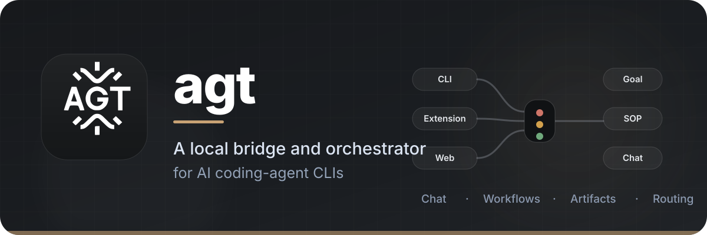

# agt



[中文文档](README_zh.md) | **English**

`agt` is a local bridge and orchestrator for AI coding-agent CLIs. It gives
Claude Code, Codex, Cursor Agent, GitHub Copilot, Qwen, Kimi, OpenCode,
OpenClaw, and custom CLIs one interface for chat, queued execution, multi-agent
workflows, artifacts, and distributed routing.

> **Status:** early and under active development. The CLI, server, daemon,
> Goal orchestration, and SOP workflows are usable; the desktop client is still
> planned and its framework has not been chosen.

## Highlights

- **Provider-neutral CLI** — discover, run, and resume installed agent CLIs.
- **Structured runs** — stream text, thinking, tool calls, tool results, and
  token/cost usage where the provider supports them.
- **Goal orchestration** — let a root agent decompose an objective, spawn child
  agents, share context, and synthesize deliverables.
- **SOP workflows** — define repeatable multi-agent DAGs in YAML.
- **Artifacts** — register outputs as addressable objects with lineage,
  summaries, and SHA-256 hashes.
- **Distributed daemons** — route work across machines over HTTP or
  NAT-friendly reverse-dial WebSocket connections.

## Requirements

- Python 3.12+
- At least one supported agent CLI installed and authenticated
- [uv](https://docs.astral.sh/uv/) for source installs, or pip

## Quick start

### Install from pip

```bash
python -m pip install agt-team

agt probe
agt run --provider claude --prompt "Summarize the current repository"
```

For queued execution and orchestration, start the server and local daemon:

```bash
agt server start --detach
agt daemon start --detach
agt task submit --prompt "Say hello" --provider claude
```

### Install from source

```bash
git clone https://github.com/half-island-box/agent-team.git
cd agent-team
uv sync

uv run agt probe
uv run agt run --provider claude --prompt "Summarize the current repository"
```

## Visual interfaces

`agt` can be used from the terminal, browser, or VS Code:

- **Web console** — start the server and open
  `http://127.0.0.1:8420/console/` to manage projects, agents, chat, SOPs,
  goals, daemons, identities, and usage. The page bundles ship inside the
  package (and in a source checkout one that is missing is built for you), so
  no separate `npm` step is needed to serve it.
- **VS Code extension** — connect the AGT extension to the same local server
  for editor-native chat, SOP editing, Goal runs, daemon management, and
  settings.

The server API is loopback-first. Review the deployment guide before exposing
it to another machine or network.

## Main commands

| Command | Purpose |
|---|---|
| `agt probe` | Discover installed agent CLIs |
| `agt run` | Execute one prompt |
| `agt chat` | Start, list, resume, or continue conversations |
| `agt goal` | Submit and inspect dynamic agent orchestration |
| `agt sop` | Validate and run YAML DAG workflows |
| `agt artifact` | Inspect and download artifacts |
| `agt server` | Manage the coordination server |
| `agt daemon` | Manage local or remote execution daemons |
| `agt identity` | Manage identities and routing preferences |

Run `agt --help` or see the
[CLI reference](docs/guide/commands.md) for all options.

## Architecture

```text
CLI / Web console / VS Code
        │
        ▼
     Server ── SQLite, jobs, artifacts, routing, MCP, SOP
        │
        ▼
     Daemon ── local process execution and concurrency
        │
        ▼
     Agent CLIs ── provider-native sessions and streaming
```

The Python package keeps orchestration, server, daemon, runtime adapters, and
CLI concerns in separate modules. Agent CLIs run as subprocesses; `agt` does not
reimplement or embed their models.

## Documentation

- [Quick start and deployment](docs/guide/quick_start.md)
- [CLI reference](docs/guide/commands.md)
- [Provider registration](docs/guide/provider-registration.md)

## Development

```bash
uv sync
uv run pytest
uv run agt --help
```

Please keep changes small and Python-first, add provider-specific behavior in
runtime adapters, and run the relevant tests before opening a pull request.

## Contributing

Issues and pull requests are welcome. For substantial architecture or provider
changes, open an issue first to discuss the design.

## License

Released under the [MIT License](LICENSE).
