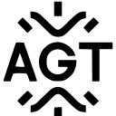
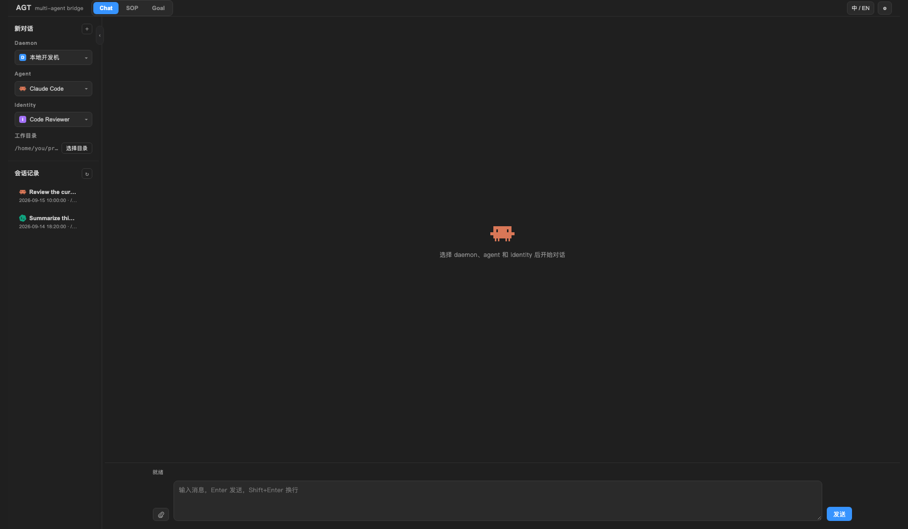

# AGT — Multi-Agent Bridge for VS Code

**AGT** brings the local `agt` server into your editor: chat with installed coding-agent CLIs, run repeatable SOP workflows, submit goals to a multi-agent orchestrator, and manage local or remote daemons without leaving VS Code.

## What you can do

### Chat with any registered agent

Pick a daemon, agent runtime, and optional identity, then start or resume a persisted conversation. Chat supports file attachments, Markdown responses, session history, and task controls alongside the normal streaming response.

### Build and run SOP workflows

Create SOPs from a template or open an existing YAML file with the visual editor. Arrange tasks as a DAG, connect outputs to downstream inputs, select identities and execution directories, validate against the server, then run the workflow and inspect per-node status and logs without switching to a terminal.

### Orchestrate goal-driven work

Submit an objective to Goal mode and follow its job tree as the root agent delegates work to child agents. AGT records artifacts, job state, and run history so you can review what each agent produced.

### Manage daemons and agent runtimes

See which daemons and coding-agent runtimes are online, refresh targets, and route work to the machine or provider you want. Remote daemons can connect back to the server through NAT-friendly reverse-dial WebSocket connections.

### Track token usage

The **Usage** view sits below the daemon tree. It summarizes input, output, cache-read tokens and request counts for the selected agent and time range, with a daemon × agent × model breakdown, so you can see where a workspace's usage comes from without leaving the editor.

### Configure everything from the editor

The settings view exposes server and daemon lifecycle controls, startup commands, remote-daemon pairing, daemon execution settings, identity management, and optional daemon/provider routing preferences.

## Highlights

- **Editor-native multi-agent workspace** — Chat, SOP, and Goal modes share one connection to your local AGT server.
- **Self-contained setup** — detects an existing backend and, on first run, offers to install the latest `agt-team` into a private environment.
- **Provider-neutral** — use Claude Code, Codex, Cursor Agent, GitHub Copilot, Qwen, Kimi, OpenClaw, OpenCode, or custom registered CLIs.
- **Visual SOP editing** — edit YAML and a DAG view together, with server-side validation and workflow execution.
- **Distributed execution** — run agents on local or remote daemons, including machines behind NAT.
- **Identity routing** — create identities and use optional routing hints by daemon and provider.
- **Bilingual UI** — switch the extension interface between Chinese and English.

## Requirements

- Python 3.12+, or [uv](https://docs.astral.sh/uv/) (the extension can create a private environment and install the backend for you)
- At least one supported agent CLI installed and authenticated
- VS Code 1.104 or newer

On first activation the extension looks for `agt` in its own private environment,
then on `PATH`, then in an `agt-team` source checkout. If none is found it asks
before installing the latest `agt-team` from PyPI into an extension-private
environment — nothing is installed without confirming that dialog, and your
system Python and other projects are left untouched.

Commands can be overridden with `agt.startCommand` / `agt.stopCommand` (and the
daemon equivalents); leave them empty to use the detected backend. `agt.agtPath`
pins a specific executable, and `agt.autoInstallBackend` controls whether the
first-run prompt appears.

## Notes

AGT is under active development. The VS Code extension is an early client for an AGT server running on your machine; it does not bundle agent CLIs or their credentials. Agent execution always uses the providers and daemons configured in your local AGT environment.

## Feedback

Issues and contributions are welcome in the [agent-team repository](https://github.com/half-island-box/agent-team).
